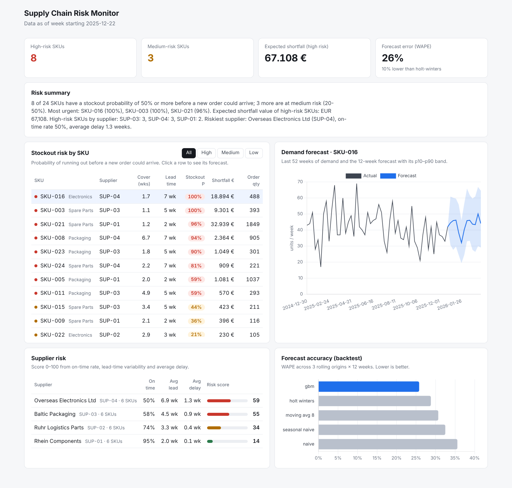

# Supply Chain Risk Monitor

Demand forecasting, stockout risk and supplier risk for a multi-supplier supply chain,
served through a FastAPI backend and a TypeScript dashboard.



## The problem

A planner with dozens of articles and several suppliers needs to answer three questions every week:

1. **How much will we sell?** Weekly demand forecast per article, with an uncertainty range.
2. **Where will we run out?** Which articles will likely hit zero stock *before a new order could even arrive*.
3. **Which suppliers put us at risk?** Who delivers late, how late, and how unpredictably.

This project answers all three from demand history, current stock, open purchase orders and
supplier delivery history.

## Approach

```
 data.py ──► forecast.py ──► risk.py ──► api.py ──► frontend/ (TypeScript)
 demand,      5 models,       Monte Carlo     FastAPI       dashboard
 deliveries,  rolling-origin  stockout sim,   + Pydantic    (Vite, Chart.js)
 inventory    backtest        supplier score  schemas
```

**Data** (`scrm/data.py`). A reproducible synthetic dataset (seeded): 24 SKUs in 3 categories,
4 suppliers, 156 weeks of demand, 888 historical purchase orders, current stock and open orders.
Demand has trend, yearly seasonality, planned promotions and overdispersed (Gamma-Poisson) noise.
Suppliers differ in lead time, lead-time variability and delay probability. Synthetic data was
chosen so the project runs offline with no account; the loaders work on any data with the same
columns.

**Forecasting** (`scrm/forecast.py`, `scrm/backtest.py`). Five models, all evaluated on the
same rolling-origin backtest (3 origins × 12-week horizon × 24 SKUs = 864 forecast points each):

| Model | WAPE | MAE (units/wk) | Bias |
|---|---|---|---|
| **Global gradient boosting (scikit-learn)** | **25.8%** | **26.2** | +0.8% |
| Holt-Winters, damped trend + 52-wk season (statsmodels) | 28.8% | 29.2 | −0.9% |
| 8-week moving average | 30.7% | 31.2 | −2.7% |
| Seasonal naive (same week last year) | 32.5% | 33.1 | −5.0% |
| Naive (last week) | 35.7% | 36.2 | +5.7% |

The gradient-boosting model reduces WAPE by **10.3%** relative to the best baseline (Holt-Winters).
It is a single global model across all SKUs, trained on per-SKU scaled features (recent means,
last year's value, week-of-year, planned promotions), with one direct prediction per horizon.
A unit test proves it has no look-ahead leakage: corrupting all data after the forecast origin
leaves the forecast unchanged.

Prediction intervals (p10/p90) come from the backtest's empirical forecast errors per horizon.
They cover 77.7% of backtest actuals against a nominal 80% (measured on the same data they were
fitted on, so this is an in-sample check).

**Stockout risk** (`scrm/risk.py`). For each SKU, 2,000 Monte Carlo runs simulate week by week:
demand = forecast × log-normal error (spread from the backtest), and each open purchase order
arrives at its promised week plus a delay sampled from *that supplier's own* delivery history.
The risk window is the replenishment lead time: a shortage inside it cannot be fixed by ordering
today, only by expediting. Output per SKU: stockout probability, expected shortfall in units and
EUR, and a suggested order quantity covering lead time + a 4-week review period at the 95th
percentile of simulated demand.

**Supplier risk.** A transparent score from 0 to 100:
`100 × (0.5 × late rate + 0.3 × min(lead-time CV / 0.5, 1) + 0.2 × min(mean delay / 2 wk, 1))`.
It ranks the suppliers in the same order as their configured reliability (on-time rates from 95%
down to 50%).

## Current results (as of the last simulated week)

- 8 of 24 SKUs at high stockout risk (≥ 50%) and 3 at medium risk (20–50%)
- Expected shortfall of the high-risk SKUs: about EUR 67,000
- 6 of the 8 high-risk SKUs come from the two least reliable suppliers

## Run it

```bash
pip install -r requirements-dev.txt
python -m scrm.backtest            # writes reports/backtest.json (about 25 s)
uvicorn scrm.api:app --reload      # API on http://localhost:8000, docs at /docs
```

Dashboard, in a second terminal:

```bash
cd frontend && npm install && npm run dev   # http://localhost:5173
```

Or everything in one container:

```bash
docker build -t scrm . && docker run -p 8000:8000 scrm   # dashboard at http://localhost:8000
```

Tests and lint: `pytest -q` (13 tests) and `ruff check scrm tests`. GitHub Actions runs both, plus
the TypeScript type check and build.

## API

| Endpoint | Returns |
|---|---|
| `GET /api/summary` | Plain-language risk summary and headline counts |
| `GET /api/risk/stockouts?level=high` | Stockout risk per SKU, sorted, optional filter |
| `GET /api/risk/suppliers` | Supplier risk scores and delivery statistics |
| `GET /api/skus` | Article master data |
| `GET /api/skus/{sku_id}/forecast` | History + 12-week forecast with p10/p90 |
| `GET /api/backtest` | Full model comparison |

All responses are validated with Pydantic models; the TypeScript client in `frontend/src/api.ts`
mirrors them.

## Project layout

```
scrm/            Python package: data, forecast, backtest, risk, engine, api
tests/           pytest: leakage test, risk edge cases, API contract
frontend/        TypeScript dashboard (Vite, Chart.js), no framework
reports/         backtest.json produced by `python -m scrm.backtest`
docs/            screenshots
```

## Limitations and next steps

- Data is synthetic. The next step would be a public retail or supply chain dataset with the same
  columns, such as the M5 forecasting data.
- Demand errors are sampled independently per week, which slightly understates multi-week risk.
- The supplier score weights are hand-set, not learned.
- Possible extension: an LLM that turns the risk tables into a weekly briefing for planners; the
  current summary is rule-based.
